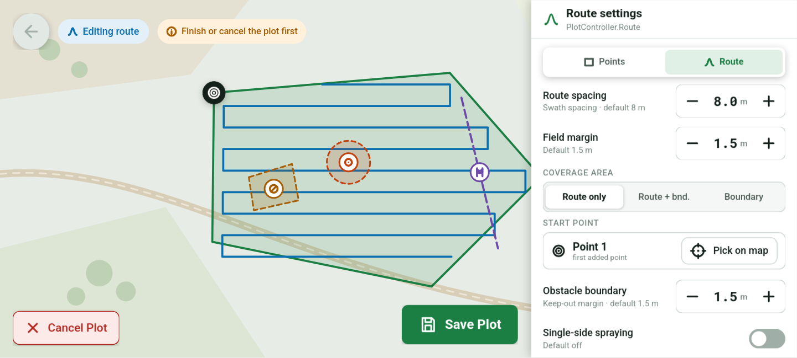

# SumSpec

**A type-safe spec language for spec-driven development :
humans and AI agents edit it and approve each other's
changes, and agents generate the application from it.**

## The idea

In AI agents era, spec-driven development has become popular more and more:
write the specification first, have a human approve it, and let an agent
generate the code from it. But markdown documents are long, ambiguous,
and hard to keep consistent as they grow. Nothing tells you that two
sections contradict each other, that a state has no way out, or that a
rename missed a paragraph.

SumSpec keeps the workflow and changes the spec. The specification is
written in a type-safe language instead of human language, You
describe the application in [algebraic data type](https://en.wikipedia.org/wiki/Algebraic_data_type) and
transitions ([finite-state machine](https://en.wikipedia.org/wiki/Finite-state_machine))

**For example we describe the git: Git's file life cycle:**

```haskell
Repository
  = Uninitialized
  | Initialized (Head * Branches * Files * Operation)

Files = [FileState by Path]

FileState
  = Untracked
  | Unmodified
  | Modified
  | Staged
  | StagedAndModified
  | Conflicted

add Path#p
  :: Files[p]
  => FileState.{Untracked | Modified | StagedAndModified}
  -> FileState.Staged
```

**We can describe UI too**, for example I gave this to Opus 4.5 and it generates the below design in [Penpot](https://penpot.app/?utm_red=g&utm_group=&gad_source=1&gad_campaignid=23620085724) for me:

```haskell
App = Map * Plots * NewPlot

NewPlot
  = Closed
  | Open PlotController

PlotController  @control segmented
                @region panel
                @placement right
  = Points
  | Route RouteSettings

RouteSettings           @view form
  = RouteSpacing        @control stepper
  * FieldMargin         @control stepper
  * CoverageArea        @control segmented
  * StartPoint          @control point_picker
  * ObstacleBoundary    @control stepper
  * SingleSideSpraying  @control toggle

RouteSpacing        = Meter @default 8
FieldMargin         = Meter @default 1.5
StartPoint          = Point @default first_point
ObstacleBoundary    = Meter @default 1.5
SingleSideSpraying  = Bool  @default False

CoverageArea
  = RouteOnly
  | RouteAndBoundray
  | Boundary

savePlot :: App => NewPlot.Open -> Plots' * NewPlot.Closed
    @control button

cancelPlot :: App => NewPlot.Open -> NewPlot.Closed
    @control button
```



## Core concepts

In SumSpec we express state with type, so a type here is equivalent to a state in state-machine.

### Product Type

```haskell
T = A * B
```

This is a type named T that is a product of A and B.

### Sum Type

```haskell
Y = V1 | V2
```

The type Y has two variants V1 and V2. Each variant can carry one optional Type too.

```haskell
Y = V1
  | V2
  | V3 A
```

Now Y is a sum of V1, V2 and `V3 A`.

### State Transitions

```haskell
t :: A -> B
```

This is a transition of the event `t`: when `t` happens, the app moves from state A (Type A) to state B (Type B).

We show a state (in a transition) like this:

```haskell
trans1 :: Y.V1 -> Y.V3(A)

Z = Y * C

trans2 :: Z(Y.V1 * C) -> Z(Y.V2 * C)
```

The transition of trans1 changes state Y.V1 to Y.V3(A). We show the state of product types with parenthesis: `Z(...)`, and refer to sum types with dot `Y.V1`. The State of a variant with a value is shown like a product type, `Y.V3(A)`.

**More Examples:**

```haskell
T2 = A
   | B (X * Y * Z)
   | C

trans3 :: T2.A -> T2.B(X * Y * Z)
```

## Examples

- `example/drone.sumspec`: a drone mission planner app.
- `example/todomvc.sumspec`: the user interface of [TodoMVC](https://todomvc.com).
- `example/git.sumspec`: the core of a local [Git](https://git-scm.com) repository.

## Workflow

- **Types at the core, prose where it helps.** The states and
  transitions are types; the intent behind them, the reasons and the
  edge cases go in comments next to the definitions they explain. The
  checker holds the core, and the comments never have to carry it.
- **Humans and AI agents work on it together.** A spec is short, and it
  reads as a list of states and of what each event does, without the
  noise of an implementation. It's a round trip: a human writes or
  changes the spec and the agent reviews it, or the agent proposes a
  change and the human approves it, and around again. Every change, from
  either side, passes the checker before anyone reviews it.
- **AI agents generate from it.** An agent builds the application from
  the exact states and transitions the spec lists, instead of guessing
  from prose.
- **The type system maintains it.** The state is a type, so a state that
  isn't in the type can't happen ("loading and failed at the same time"
  can't be written). Every change is a transition from one state to
  another. The checker reports unknown names, impossible patterns,
  states nothing ever reaches, transitions that can never happen, and
  two transitions of one event that compete for the same state, before
  any code exists.
- **Language tools support it.** Like any programming language, a spec
  gets tooling: the `sumspec` checker today, and a language server
  (errors as you type, go-to-definition, syntax highlighting) next.

In short: spec-driven development, where the spec is easier to maintain
because a type system and real language tools look after it.

Tip: For frontend development it is the best practice to follow TEA (The Elm Architecture) as far as this language is close to it.

## Where it's useful

- **Spec-driven development with AI agents.** Humans and agents both
  edit the spec and approve each other's changes; the agent generates
  the code from it, and it stays the reference after the code exists:
  change the spec, check it, approve it, and regenerate.
- **User interfaces.** Screens, modes, forms, loading and error states:
  every combination the UI can show is in the type, and every user
  action is a transition.
- **Application cores and protocols.** A repository, an order, a
  connection, a device: anything with a life cycle and rules about what
  may happen when.
- **Design reviews.** A spec is something a team can read and argue
  about before writing code, and the checker answers questions like
  "can this state ever be reached?".

## Tutorial

Check out `./spec/spec-v1.md`.

## Influences

- [**Haskell**](https://en.wikipedia.org/wiki/Haskell) and the ML family: for syntax.
- [**TEA (The Elm Architecture):**](https://guide.elm-lang.org/architecture/) for describing the state and event
- [**Type theory:**](https://en.wikipedia.org/wiki/Type_theory) for states
- [**Extended finite state machines (EFSM):**](https://en.wikipedia.org/wiki/Extended_finite-state_machine) for transitions.

## The language

- `spec/spec-v1.md`: the language definition (version 1.0, in
  development).
- `spec/grammar.ebnf`: the grammar.
- `spec/proposals.md`: ideas for later versions.

## The `sumspec` tool

`sumspec check FILE` parses and type-checks a spec. It prints nothing
for a valid spec, or every error and warning with its position.
`sumspec parse FILE` prints a spec back in canonical form.
`sumspec lsp` is a language server that shows the same errors and
warnings in your editor as you type (Neovim: `editors/nvim/README.md`).

Install it with Nix (flakes enabled), from a clone of this repository:

```
nix profile install .
```

Or run it without installing: `nix run . -- check FILE`. To build it with
cabal, run the tests, or contribute, see [DEVELOPMENT.md](DEVELOPMENT.md).

## Vibe Coded vs Human Revised

The files that are human revised vs fully vibe coded:

| File                      | Human Revised
|---------------------------|--------------
| `./README.md`             | Yes+
| `./spec/spec-v1.md`       | Yes+
| `./example/*`             | Yes+
| `./flake.nix`             | Yes+
| `./DEVELOPMENT.md`        | Yes
| `./src/SumSpec/Syntax.hs` | Yes
| `./test/check/*`          | Yes
| `./TODO.md`               | Yes
| `./spec/proposals.md`     | Partial
| `./spec/grammar.ebnf`     | Partial
| `./test/parse/*`          | Partial

Every thing else today is vibe coded without human revised.
